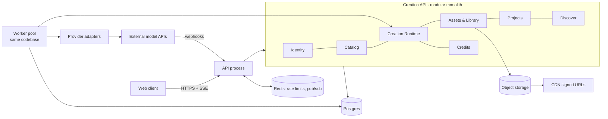
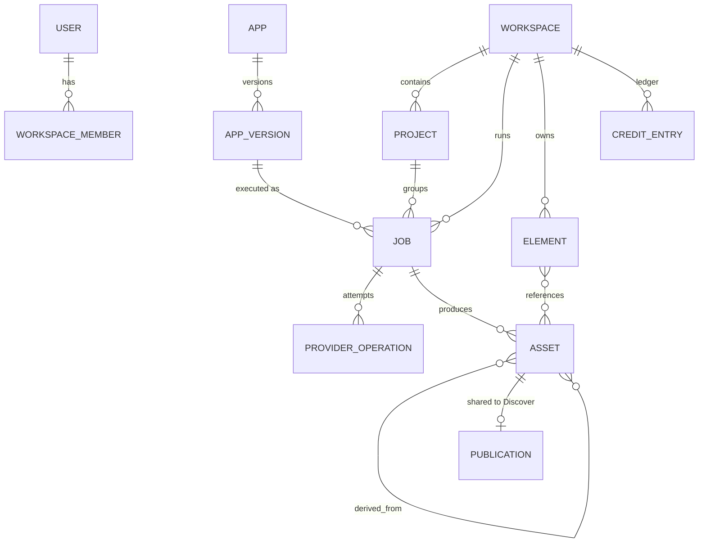
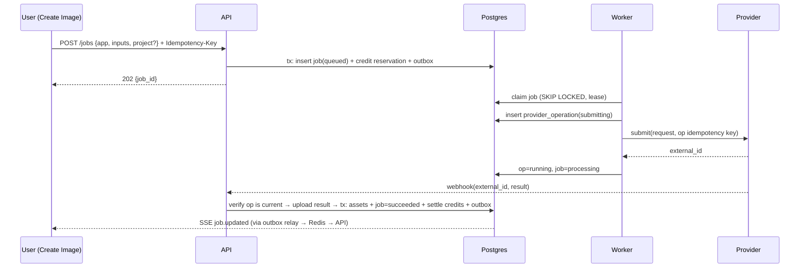

# Production System Design: Creation Product v1

## 1. Scope and principles

This document designs the whole Creation product shown in the production Figma:

- **Home:** Continue Working, promoted Apps, Model Labs and community work.
- **Apps:** a catalog of creation tools.
- **Projects:** a user's workspaces.
- **Library:** Assets by project, Characters and typed Elements.
- **Jobs:** In Progress and Complete lists.
- **Discover:** Featured/Favorites feeds with Remix.

Create Image is one App among many, not the center of the design.

Guiding rule: build the smallest system that is *correct* for paid, long-running, provider-backed generation. Defer anything that only matters at scale.

| Concern | Launch (v1) | Later scale |
|---|---|---|
| Runtime | One modular-monolith API + one worker pool, same codebase | Split hot modules (e.g. Discover feed) only if load proves it |
| State | Postgres (single primary + read replica) | Partition `jobs`/`assets` by time; dedicated feed store |
| Queue | Postgres job table with `SKIP LOCKED` leases | Managed queue only if dispatch throughput exceeds Postgres |
| Live updates | SSE from API, fan-out via Redis pub/sub | Dedicated realtime gateway |
| Media | Object storage + CDN, signed URLs | Multi-region replication, tiered storage |
| Apps | Code-registered manifests + handlers | Third-party/partner Apps behind review |
| Providers | 3–5 image/video adapters | Smart routing, fallback, price-aware selection |

## 2. Architecture and ownership

One deployable codebase runs in two process roles: **API** (HTTP, SSE, webhooks) and **worker** (job execution). They share modules and the database.

**Why a modular monolith.** Job, asset, credit and outbox state must change atomically; one database is simpler and safer than coordinating those writes across services.

Module ownership mirrors the domain-first layout of the submitted code. Each module owns its tables, and other modules use it only through its public interface:

| Module | Owns | Surfaces |
|---|---|---|
| Identity | users, workspaces, memberships, sessions | all |
| Catalog | App + AppVersion manifests, model metadata, feature flags | Apps, Home (Trending, Model Labs) |
| Creation Runtime | jobs, provider_operations, state machine, dispatch | Jobs, every App |
| Assets & Library | assets, elements, lineage, storage keys | Library, Projects, Discover |
| Projects | projects, membership of assets/jobs in projects | Projects, Home (Continue Working) |
| Discover | publications, favorites, remix links, moderation state | Discover, Home showcase |
| Credits | append-only credit ledger, reservations, plans | Generate buttons (⚡ cost), billing |

## 3. Domain and data model

- **User / Workspace.** Every resource belongs to a workspace, giving solo users and later teams one authorization model.
- **App / AppVersion.** A versioned manifest holds the input schema, output kinds, provider capability and cost formula. Jobs pin a version so history remains meaningful after changes.
- **Project.** The user-facing container. Every Job has a `project_id`; starting without one creates "Untitled Project #n".
- **Job.** One user action: validated inputs, idempotency key, status, reserved credits and timestamps.
- **ProviderOperation.** One provider attempt, including external id, idempotency key, status, lease, deadline and raw error. Exactly one operation per Job may be current.
- **Asset.** An immutable output with storage key, media metadata, `job_id`, `project_id` and lineage.
- **Element.** A named Character, Product, Scene, Brand or Style backed by Assets and structured attributes.

**How assets reach the Library.** The Library queries workspace-scoped `assets` and `elements`; it is not a copy. Every App inserts Assets in the **same transaction** that marks its Job `succeeded`, so App, Remix and Project outputs appear immediately. Characters and Elements read `elements`; "Save as Element" references existing Assets.

## 4. End-to-end flows

1. **Start in an App.** The user picks inputs (optionally Elements) and clicks Generate. The client sends one Idempotency-Key per click. The API validates against the AppVersion schema, checks quotas, reserves credits and creates a `queued` Job, all in one transaction. It returns `202` straight away.
2. **Async execution.** A worker claims the job and runs the App handler's `plan(inputs)`, which yields one provider request per required output. It then creates ProviderOperations and submits them.
3. **Jobs tracking.** Every state change writes an outbox row in the same transaction. A relay publishes those rows to Redis, and API nodes push them over SSE. The Jobs page and any open App update live. A reconnecting client re-fetches a snapshot, so a missed event never leaves it stale.
4. **Continue in Projects.** Finished Assets belong to the Job's Project. The completion transaction updates `last_activity_at` for Home's Continue Working. Edit or re-run starts a new Job linked through `derived_from`.
5. **Find in Library.** The Assets are already there, grouped under the project.
6. **Remix from Discover.** A published Asset carries its App, AppVersion and sanitized inputs. Remix opens that App prefilled. The new Job records `derived_from` the source asset and lands in the remixer's own Project and Library.

## 5. Long-running work

**Durable state and dispatch.** Jobs and operations live in Postgres. Workers claim work with `SELECT … FOR UPDATE SKIP LOCKED`, take a **lease** (`leased_until`) and extend it with heartbeats. I chose Postgres over a separate broker for launch because the claim, the state transition and the outbox write then commit atomically. A broker would bring dual-write problems before we have the load to need one.

**State machine and transition ownership.**

| From | To | Owner |
|---|---|---|
| — | queued | API (create) |
| queued | processing | Worker (claim + submit) |
| processing | succeeded / failed | Worker or webhook handler, only via the *current* operation |
| queued / processing | cancel_requested → cancelled | API requests; worker confirms |
| processing | queued | Reconciler (lease expired, retry budget left) |

Every transition is a compare-and-set: `UPDATE … SET status=$to, version=version+1 WHERE id=$id AND status=$from`. If zero rows change, someone else already moved the job, and the caller drops its update. This one rule makes duplicate webhooks, racing workers and late retries harmless.

**Idempotency.**
- *Client to API:* `(workspace_id, idempotency_key)` is unique, and a replay returns the original Job.
- *Worker to provider:* each operation sends its own key (`job_id:attempt`) wherever the provider supports one.
- *Webhooks:* deduplicated on `(provider, external_id, event_type)`.

**Retries and timeouts.** Errors are classified by each adapter as *retryable* (429, 5xx, network) or *terminal* (content rejected, invalid input). Retryable errors get a new operation with exponential backoff and jitter, up to N attempts. Deadlines depend on the capability: about 2 minutes for images and about 30 minutes for video. While the provider reports progress, video operations are polled at a slow backoff in addition to the webhook. A missed deadline cancels the provider operation where possible and either retries or fails the Job.

**Concurrency and provider limits.**
- *Per workspace:* create locks a workspace quota row, verifies the active-job count, inserts the Job and commits before releasing the lock. This makes concurrent creates respect any plan limit, not only a limit of one.
- *Per provider:* a concurrency and rate budget held as a Redis token bucket, checked before submit. A job that finds the budget empty stays `queued`, with `not_before` pushed back, instead of failing.
- *Priority:* paid plans get priority through claim ordering.

**Cancellation and stale completions.** Cancel sets `cancel_requested`. The worker calls the adapter's `cancel` (best effort) and moves the Job to `cancelled`. Unused credits are released. A completion that arrives for a non-current operation, or for a cancelled Job, fails the CAS check. Its output is recorded for audit but never attached to the Job and never charged to the user.

**Recovery.** A **reconciler** runs every minute and handles three cases:
1. Expired leases go back to `queued` if they have retry budget, otherwise to `failed`.
2. Operations that are `running` but past their deadline are re-polled by `external_id` first, so a worker crash does not mean resubmitting (and paying for) work the provider is already doing.
3. Orphaned credit reservations are released.

**Operational visibility.** Track queue depth/age, latency percentiles, errors, retries and provider spend. Trace each Job from POST through webhook; provide an admin operation view. Alert on queue age, provider errors and spend anomalies.

## 6. App and provider extensibility

An **App** is a code module plus a manifest, registered with the Catalog:

- `manifest`: id, version, input schema (JSON Schema), output kinds, required capability, cost formula, UI hints.
- `plan(inputs, elements) -> [ProviderRequest]`
- `finalize(operation_results) -> [AssetDraft]`

A **Provider** is an adapter registered by capability:

- `submit(request, idem_key) -> external_id`
- `poll(external_id)` / `parse_webhook(payload)` → normalized events (`Started`, `Progress`, `Completed(media)`, `Failed(class, msg)`)
- `cancel(external_id)`, `estimate_cost(request)`, `limits()`

The Runtime only knows these interfaces. Adding an App means a new module, a manifest and a frontend view for its composer. Adding a provider means a new adapter, its secrets and a routing entry. Jobs, the Library, Projects, Credits and the Jobs page all stay untouched. There is deliberately no DSL, no generic workflow engine and no no-code builder: a multi-step App is ordinary code inside `plan` and `finalize`, and the Runtime retries each operation independently.

## 7. Security, cost and rollout

- **Identity and authorization:** managed OIDC, HTTP-only session cookies and repository-layer `workspace_id` scoping.
- **Private assets:** private buckets and short-lived signed CDN URLs. Discover uses a public derivative, never the original.
- **Secrets:** provider keys live in a secrets manager, load only in workers and rotate per environment.
- **Abuse:** moderate prompts and outputs before visibility; rate-limit users/IPs and provide a Discover report queue.
- **Quotas and budgets:** credits are *reserved* at create and *settled* on success, so a failed job is never charged. Plans cap concurrency. A per-provider daily spend circuit breaker pauses dispatch when it trips.
- **Retention:** keep failed-job inputs and deleted Assets for 30 days; minimize and access-log raw provider payloads.
- **Cost controls:** show Generate cost, monitor spend per App/provider and prefer cheaper providers when quality permits.
- **Rollout:** feature flags, internal testing, closed beta, then GA. Shadow each new provider before routing real traffic.

